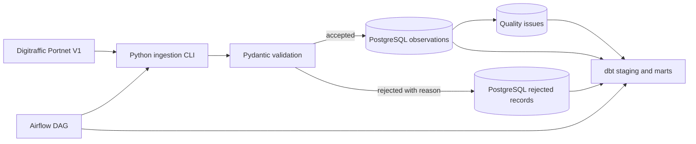
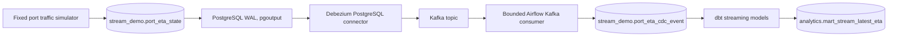
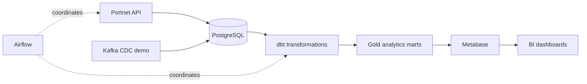

# PortPulse Architecture

PortPulse contains a deterministic synthetic ETA reconciliation example and a separate real-data workflow for Finnish Portnet V1 records. Airflow orchestrates the Portnet path; it does not run the synthetic reconciliation workflow.

## Portnet workflow

The CLI fetches a UTC collection date from the Portnet V1 REST API. Pydantic validates external records at ingestion. Accepted observations, rejected records, and duplicate or ID-collision quality issues are stored in dedicated PostgreSQL tables. Provider event time, API collection time, and database ingestion time are represented separately in UTC.

The dbt project reads the Portnet tables in `public` and builds `analytics.stg_portnet_eta`, `analytics.mart_portnet_latest_eta`, and `analytics.mart_pipeline_quality`. The latest mart selects an eligible observation per port call and area and excludes collided event IDs. dbt tests run as part of `dbt build`.

The `portpulse_daily_pipeline` Airflow DAG runs ingestion followed by `dbt build`, which runs the model and data tests. The DAG is paused on initial setup; its schedule is 06:00 UTC when enabled.

## Synthetic ETA reconciliation

The synthetic JSONL fixture is validated and reconciled across three simulated sources using the project’s deterministic rules. It exercises quarantine, duplicate and collision handling, and trusted ETA selection. Its tables and output are distinct from Portnet observations; real Portnet records do not enter this reconciliation engine.

Portnet reliability tests use deterministic API-shaped responses, including revisions, duplicates, collisions, invalid records, and missing ETAs. They mock the API, replay data in a disposable PostgreSQL database, and run the normal dbt models; the production Airflow DAG continues to ingest only real Portnet data.

## Optional simulated CDC workflow

Kafka carries committed row changes as an ordered event stream; Debezium reads PostgreSQL's logical WAL through `pgoutput` and publishes those changes without a custom producer. Airflow uses the official Kafka consumer operator for bounded, scheduled micro-batches, then runs `dbt build` and its model tests. PostgreSQL event storage is idempotent by Kafka topic, partition, and offset, so a task retry after a database commit can safely replay messages. This is at-least-once processing, not end-to-end exactly-once delivery.

All generated rows and CDC history stay in `stream_demo`; the real Portnet tables and production daily DAG remain separate. Existing three-source synthetic fixtures test reconciliation, while the Portnet API fixtures test ingestion reliability. The traffic simulator is a third test/demo input that creates database INSERT, UPDATE, and DELETE operations for Debezium to capture.

The local broker uses a single KRaft node and has no host-published Kafka port. It is a demonstration, not a durable production cluster. Kafka ordering is guaranteed only within a partition; each simulated call key must continue mapping to one partition, and changing the topic's partition count can invalidate cross-version ordering assumptions. Pausing Debezium can retain WAL through its replication slot. DDL changes are not emitted as CDC events. See [the streaming guide](docs/streaming_cdc.md).

## BI dashboards

Airflow coordinates ingestion and dbt transformations. Metabase reads the finished marts; it does not ingest or transform source data. The Portnet dashboard uses only real Portnet marts, while a separate dashboard labels simulated CDC rows. See [the Metabase guide](docs/metabase.md).

## Local deployment and limits

Docker Compose starts PostgreSQL, Airflow, Metabase, Kafka, and Kafka Connect. One-shot setup containers wait for their dependencies, build the dbt marts, configure the read-only analytics account, create and check both dashboards, and register the Debezium connector. The streaming Airflow DAG remains paused until a user runs it. Python, Airflow, and dbt dependencies are installed in the shared application image. PostgreSQL application data and Airflow SQLite metadata use separate named volumes.

This is a local learning/demo deployment. Compose binds the service ports to loopback and uses documented demo credentials. It is not configured or claimed as production-ready. See [the README](README.md) for running it and [the database guide](docs/database.md) for volume and migration operations.
