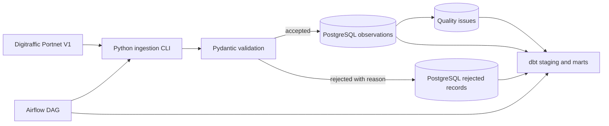
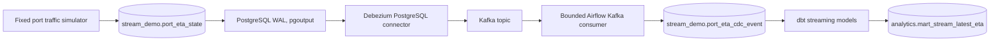
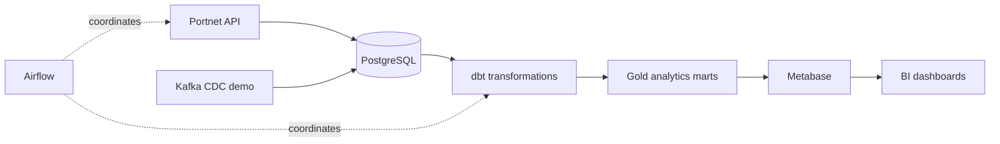

# PortPulse Architecture

PortPulse contains a real-data workflow for Finnish Port Call V1 records, a deterministic synthetic ETA demonstration, and a separate simulated CDC workflow. The recommended `portpulse_full_pipeline` Airflow DAG orchestrates **real ingestion and synthetic generation/ingestion together**, then runs `dbt build`. The original reconciliation fixture is a separate, earlier test path.

## Portnet workflow

The CLI fetches a UTC collection date from the Digitraffic Port Call V1 REST API. Python checks the raw response shape and Pydantic validates normalized marine ETA event models; Pydantic does not validate every incoming message. Accepted observations, rejected records, and duplicate or ID-collision quality issues are stored in dedicated PostgreSQL tables. Provider event time, API collection time, and database ingestion time are represented separately in UTC. The V1 adapter will eventually stop receiving new data; a V2 adapter remains future work.

The dbt project reads the Portnet tables in `public` and builds `analytics.stg_portnet_eta`, `analytics.mart_portnet_latest_eta`, and `analytics.mart_pipeline_quality`. The latest mart selects an eligible observation per port call and area and excludes collided event IDs. dbt tests run as part of `dbt build`.

The recommended `portpulse_full_pipeline` DAG is manual-only and initially unpaused. Its real ingestion branch checks a bounded 7-day UTC window by default; its independent synthetic branch generates and ingests 1,000 fictional port calls using seed 42 by default. The branches converge on a single `dbt build` and tests step, which only runs after both ingestions succeed. The separate legacy `portpulse_daily_pipeline` is initially paused and can run real Port Call V1 ingestion at 06:00 UTC when enabled; it requests a single logical UTC date per run.

## Synthetic ETA and reconciliation examples

The full DAG's synthetic branch uses `scripts/generate_synthetic_eta.py` and `scripts/ingest_synthetic_eta.py`. Generated events are Pydantic-validated, then stored in `synthetic_demo` with separate rejected events and duplicate/collision issues. Dedicated dbt marts show daily activity, revision history, latest ETA, and quality. Seed 42/1,000 fictional calls generate 3,496 valid updates. The synthetic values represent ETA updates, **not observed arrival delays**.

The older committed synthetic JSONL fixture supports an additional standalone reconciliation/rules example across three simulated sources. It exercises quarantine and deterministic trusted ETA selection; do not confuse those fixture tables with the isolated `synthetic_demo` marts. None of the fictional data is inserted into the real Portnet tables.

Portnet reliability tests use deterministic API-shaped responses, including revisions, duplicates, collisions, invalid records, and missing ETAs. They mock the API, replay data in a disposable PostgreSQL database, and run the normal dbt models; the production Airflow DAG continues to ingest only real Portnet data.

## Optional simulated CDC workflow

Kafka carries committed row changes as an ordered event stream; Debezium reads PostgreSQL's logical WAL through `pgoutput` and publishes those changes without a custom producer. Airflow uses the official Kafka consumer operator for bounded, **manual-only** micro-batches, then runs `dbt build` and its model tests. PostgreSQL event storage is idempotent by Kafka topic, partition, and offset, so a task retry after a database commit can safely replay messages. This is at-least-once processing, not end-to-end exactly-once delivery. Kafka offsets have ordering meaning only within each partition; the latest-state mart ranks by source update time and guards the same-key partition assumption.

All generated rows and CDC history stay in `stream_demo`; the real Portnet tables and production daily DAG remain separate. Existing three-source synthetic fixtures test reconciliation, while the Portnet API fixtures test ingestion reliability. The traffic simulator is a third test/demo input that creates database INSERT, UPDATE, and DELETE operations for Debezium to capture.

The local broker uses a single KRaft node and has no host-published Kafka port. It is a demonstration, not a durable production cluster. Kafka ordering is guaranteed only within a partition; each simulated call key must continue mapping to one partition, and changing the topic's partition count can invalidate cross-version ordering assumptions. Pausing Debezium can retain WAL through its replication slot. DDL changes are not emitted as CDC events. See [the streaming guide](docs/streaming_cdc.md).

## BI dashboards

Airflow coordinates ingestion and dbt transformations. Metabase reads the finished marts; it does not ingest or transform source data. The Portnet dashboard uses only real Portnet marts. Two other dashboards separately show deterministic synthetic ETA analytics and simulated CDC rows. See [the Metabase guide](docs/metabase.md).

## Local deployment and limits

Docker Compose starts PostgreSQL, Airflow, Metabase, Kafka, and Kafka Connect. One-shot setup containers wait for their dependencies, create the Kafka CDC topic, register the Debezium connector, build the dbt marts, configure the read-only analytics account, and create and check **three dashboards** (real Portnet, synthetic ETA, simulated CDC). The streaming Airflow DAG remains paused until a user runs it. Python, Airflow, and dbt dependencies are installed in the shared application image. PostgreSQL application data and Airflow SQLite metadata use separate named volumes.

This is a local learning/demo deployment. Compose binds the service ports to loopback and uses documented demo credentials. It is not configured or claimed as production-ready. See [the README](README.md) for running it and [the database guide](docs/database.md) for volume and migration operations.

## Current scope and portability

The source ingestion module is **coupled to Digitraffic Port Call V1**. Replacing its URL with an arbitrary maritime ETA endpoint is not supported; a provider-specific adapter that normalizes a second source to the PortPulse event contract is a planned next step. A new API with different live data is not expected to return the same counts. Synthetic seed-driven outputs are deterministic on a fresh database.

This repository remains a local educational demonstrator, not a production marine forecasting system. See [the engineering assessment and clean-clone acceptance checklist](docs/engineering_readiness_assessment.md) and [the README](README.md) for current scope and verification status.
