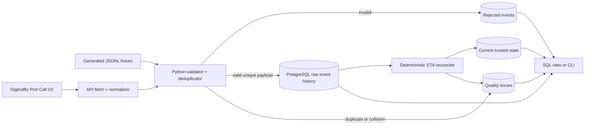
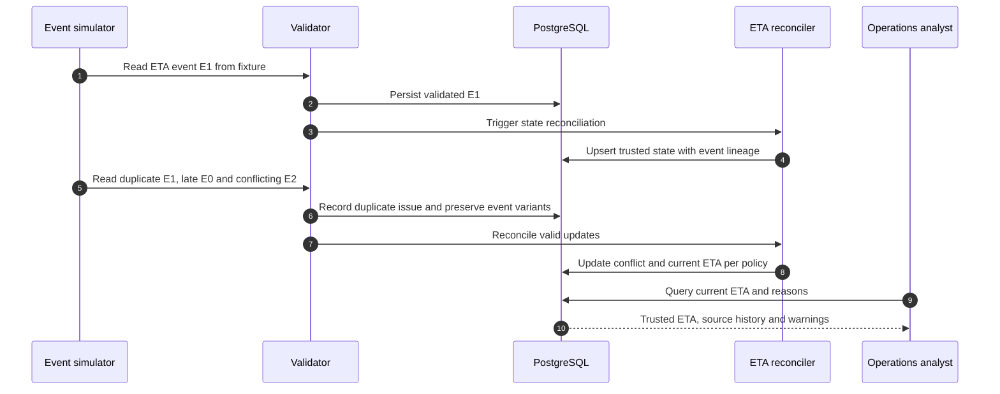

# Proposed system architecture — PortPulse — Operational Event Integrity & Terminal Readiness

**Status:** Conceptual design for mentor feasibility review. The local PostgreSQL schema, fixture ingestion, deterministic reconciliation, query CLI, replay checks, and clean-clone handover are complete for Phase 1. The diagrams are Mermaid and render in compatible Markdown viewers such as GitHub.

**Source design:** [../source_readmes/PortPulse_original_README.md](../source_readmes/PortPulse_original_README.md). This version deliberately shows the smallest end-to-end slice that addresses the business problem rather than every optional tool named in the original README.

## Delivery phases

- **Phase 1 — MVP (Steps 01–06, P0):** local synthetic fixture, PostgreSQL, validation, reconciliation, query output and replay handover.
- **Phase 2 — Stretch 1 (P1):** optional Digitraffic Marine API input adapter, richer read-only API, more synthetic scenarios and port calls, database integration checks, and operational reporting/dashboard.
- **Phase 3 — Stretch 2 (P2):** optional Kafka/cloud, orchestration, streaming, lineage and standards-conformance experiments. Start only after Phase 1; Phase 2 is the preferred first stretch.

## 1. System context and data flow




**System boundary:** All data shown are generated or licensed for the capstone. External proprietary system integration is out of scope. Software and storage choices are proposals pending group feasibility review.

### Phase 2 external input adapter

The Digitraffic adapter is an optional P1 input, separate from the frozen synthetic fixture. It fetches active visits from Port Call V2, retains the raw response, maps `visitId`, `updateTime`, `eta`, status, port and vessel identifiers, then sends normalized updates through the same validation, deduplication, collision handling and reconciliation path. A latest status other than `Expected to Arrive` makes the visit ineligible for a trusted ETA, so an old ETA is not left trusted after arrival or cancellation. Tests use fixed response samples and do not depend on live data.

For the same visit and source update timestamp, identical canonical payloads are duplicates; different payloads are ID collisions and are excluded from trusted state. A later `updateTime` creates a new event in the same visit history. Digitraffic call IDs are namespaced, so Digitraffic is the only source for those calls and wins when its event is valid and fresh. If calls are later joined across sources, record conflicts and select a winner using the configured source priority, event time and tie-break rules. The adapter records receipt and database-ingestion timestamps separately, sends `Digitraffic-User` and `Accept-Encoding: gzip`, respects request/update limits, and attributes the data under CC BY 4.0. See the [PRD's Phase 2 mapping and rules](PRD.md#phase-2-input-digitraffic-marine-api).

## 2. Entity relationship diagram (conceptual ERD)

```mermaid
erDiagram
    PORT_CALL ||--o{ RAW_EVENT : has
    SOURCE_SYSTEM ||--o{ RAW_EVENT : publishes
    PORT_CALL ||--o| PORT_CALL_STATE : has
    PORT_CALL {
        string port_call_id PK
        string vessel_id
        string port_code
    }
    SOURCE_SYSTEM {
        string source_id PK
        int priority
        int freshness_minutes
    }
    RAW_EVENT {
        int raw_event_id PK
        string event_id IDX
        string port_call_id FK
        string source_id FK
        datetime event_time_utc
        datetime received_at_utc
        datetime ingested_at_utc
        datetime eta_utc
        string schema_version
        string canonical_payload_sha256
        json raw_payload
    }
    PORT_CALL_STATE {
        string port_call_id PK
        string status
        datetime trusted_eta_utc
        string source_id FK
        string winning_event_id
        boolean conflict_flag
        datetime as_of_utc
        string rules_version
    }
    REJECTED_EVENT {
        int rejected_event_id PK
        string event_id nullable
        string reason_code
        json raw_payload
    }
    QUALITY_ISSUE {
        int quality_issue_id PK
        string event_id nullable
        string issue_code
        json details
    }
```

**Schema note:** `received_at_utc` is simulated input time; migration 003 adds database-generated `ingested_at_utc`. Existing rows are backfilled with migration time because their original ingestion time was not recorded. `raw_event` uses a surrogate key and a unique `(event_id, canonical_payload_sha256)` pair, so distinct collision variants can both be retained. Reconciliation must exclude every event ID with an `ID_COLLISION` issue. Invalid payloads go to `rejected_event`, whose event ID is nullable because malformed input may not contain one.

## 3. Sequence diagram — primary and failure scenario




The sequence demonstrates the desired behavior; it is not evidence that an integration has already been built.

## 4. Contracts and integration principles

- Every source has an explicit input schema, allowed values and timestamp policy.
- Separate source data and rejected records from trusted analytical results.
- Record sufficient provenance to explain business outputs to a reviewer.
- Use deterministic fixtures to test normal, invalid, duplicated and revised/failure cases.
- Prefer an end-to-end vertical slice over additional infrastructure without a direct role.
- Where relevant, document safe reprocessing and handling of inconsistent or missing inputs.

## 5. Architecture decision log — topics to resolve

Source precedence per field; definition of a material ETA conflict; freshness threshold; any DCSA payload mapping. Kafka is deferred for the initial local batch slice.

The team should record each accepted decision as a short ADR: **context → alternatives → decision → consequences**.

## 6. Implementation readiness review

- [ ] Input fixtures can be acquired or generated legally.
- [ ] Required fields, keys and relationships are understood by every team member.
- [ ] The main business rule is written as a deterministic test.
- [ ] Technology choice fits the actual timeline and available course skills.
- [ ] One complete input-to-result scenario can be demonstrated without optional integrations.
- [ ] Documentation and diagrams are reconciled after any scope change.

## 7. Demo

Play normal ETA → duplicate event → out-of-order older event → conflicting source. Query current state and show unchanged trusted ETA after replay, with audit reasons.
