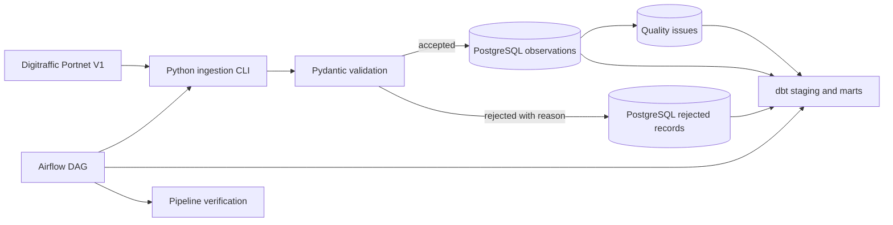

# PortPulse Architecture

PortPulse contains a deterministic synthetic reconciliation example and a separate real-data workflow for Finnish Portnet V1 records. Airflow orchestrates the Portnet path; it does not replace PostgreSQL or perform Phase 1 reconciliation.

## Portnet workflow

The CLI fetches a UTC collection date from the Portnet V1 REST API. Pydantic validates external records at ingestion. Accepted observations, rejected records, and duplicate or ID-collision quality issues are stored in dedicated PostgreSQL tables. Provider event time, API collection time, and database ingestion time are represented separately in UTC.

The dbt project reads the Portnet tables in `public` and builds `analytics.stg_portnet_eta`, `analytics.mart_portnet_latest_eta`, and `analytics.mart_pipeline_quality`. The latest mart selects an eligible observation per port call and area and excludes collided event IDs. dbt tests run as part of `dbt build`.

The `portpulse_daily_pipeline` Airflow DAG runs ingestion, dbt build, and verification sequentially. Verification checks source and model relations, counts, quality metrics, and latest-row uniqueness. The DAG is paused on initial setup; its schedule is 06:00 UTC when enabled.

## Synthetic Phase 1 workflow

The synthetic JSONL fixture is validated and reconciled across three simulated sources using the project’s deterministic rules. It exercises quarantine, duplicate and collision handling, and trusted ETA selection. Its tables and output are distinct from Portnet observations; real Portnet records do not enter this reconciliation engine.

## Local deployment and limits

Docker Compose starts PostgreSQL and an Airflow container built from the root Dockerfile. Python, Airflow, and dbt dependencies are installed in that image. The Airflow container connects to PostgreSQL by the Compose service name `db`. PostgreSQL application data and Airflow SQLite metadata use separate named volumes.

This is a local learning/demo deployment. Compose binds the service ports to loopback and uses documented demo credentials. It is not configured or claimed as production-ready. See [the README](README.md) for running it and [the database guide](docs/database.md) for volume and migration operations.
