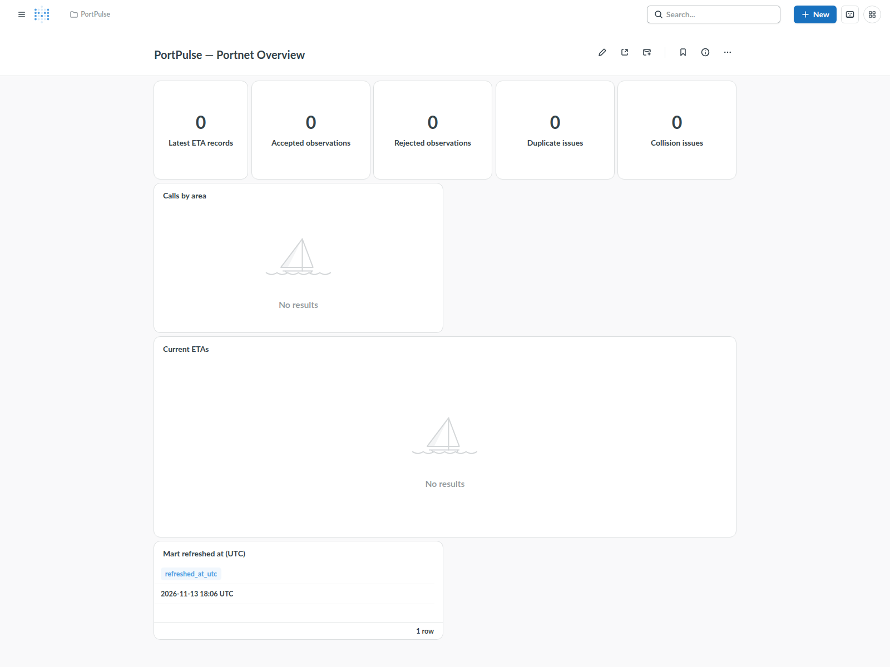

# PortPulse

PortPulse collects estimated arrival times (ETAs) from Digitraffic Portnet V1, validates them with Python and Pydantic, stores them in PostgreSQL, and builds analytics marts with dbt. Airflow runs the pipeline.

## Start PortPulse

Install Docker Engine and Docker Compose v2, then run:

```bash
docker compose up -d
```

This starts PostgreSQL, Airflow, Metabase, and a one-time setup job that builds the marts and creates the dashboards. Open [Airflow](http://localhost:8080) and [Metabase](http://localhost:3000) on your computer.

Local demo logins are `admin` / `admin` for Airflow and `admin@example.test` / `portpulse-local-demo-2026` for Metabase. Override them with the variables in `.env.example`; never use the defaults in a public deployment.

## BI dashboards

The **PortPulse — Portnet Overview** dashboard shows only real Portnet mart data. It stays empty until Portnet observations have been ingested. The **PortPulse — Kafka CDC Demo (SIMULATED DATA)** dashboard shows the separate simulated CDC example.




See the [Metabase guide](docs/metabase.md) for dashboard details and troubleshooting. Kafka and Debezium remain optional; start them only for the CDC demonstration with `docker compose --profile streaming up -d`.

## Run the Portnet pipeline

The `portpulse_daily_pipeline` DAG starts paused. In Airflow, unpause it to use its 06:00 UTC schedule, or trigger it manually. To trigger from the command line:

```bash
docker compose exec airflow airflow dags trigger portpulse_daily_pipeline
```

## Data and limits

Portnet V1 provides Finnish maritime data, not Hamburg operational port data. Availability and ETA coverage depend on [Digitraffic](https://www.digitraffic.fi/en/marine-traffic/). The latest-ETA mart contains the current record per port call and area; the quality mart is a current snapshot, not a historical trend.

PortPulse is a local learning project, not a production maritime tracking service. Do not expose Airflow, PostgreSQL, Metabase, Kafka, or Kafka Connect to the public internet.

## Documentation and tests

- [Architecture](ARCHITECTURE.md)
- [Database operations](docs/database.md)
- [Data dictionary](docs/data_dictionary.md)
- [Streaming CDC demonstration](docs/streaming_cdc.md)
- [Metabase setup and troubleshooting](docs/metabase.md)

Run Python tests and Ruff in the Airflow container:

```bash
docker compose exec airflow python -m unittest discover -s tests -v
docker compose exec airflow ruff check /opt/portpulse
```

Stop the services with `docker compose down`. This preserves database, Airflow, Kafka, and Metabase volumes.
