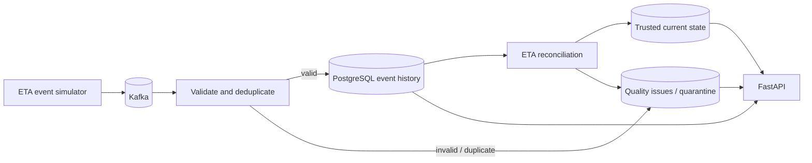
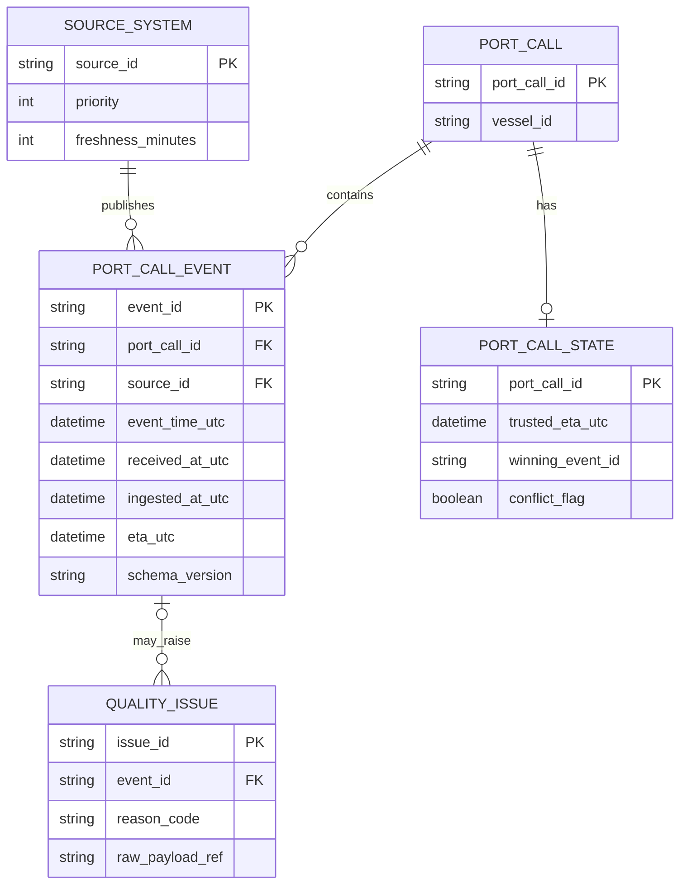

# PortPulse
**Operational Event Integrity for Port-Call Data**  
**Document:** PRD, user stories, and technical architecture · **Version:** 0.1

**Scope note:** This is the original v0.1 proposal. The current MVP scope is in [PRD_v0.2.md](PRD_v0.2.md): use a generated local fixture and PostgreSQL first; Kafka and FastAPI are deferred.

**Delivery plan:** Phase 1 is the six-step MVP (P0) and has the 10-working-day target. Phase 2 is Stretch 1 (P1): richer API, broader synthetic scenarios/multiple port calls, integration checks and reporting. Phase 3 is Stretch 2 (P2): optional advanced streaming, cloud and platform experiments. Both stretch phases follow Phase 1 and have no committed dates. See [progress.md](progress.md) and the Gantt workbooks for the detailed sequence.

## 1. Product Requirements Document (PRD)

### Problem and purpose
A vessel's estimated arrival time (ETA) can be updated by several independent sources. Messages may arrive late, twice, in the wrong order, or with conflicting values. A consumer looking only at the last message received can therefore show an unreliable ETA.

**PortPulse** is a small, reproducible **data-engineering demonstrator** that turns simulated port-call updates into a traceable **trusted current ETA**. It also explains *which event won, which inputs were rejected, and whether sources disagree or have become stale*. This is a simulated industry problem, **not a claim about a specific port's systems**.

### Intended users and success outcome
- **Operations analyst:** reads the current ETA, its source, its update time, and any warning.
- **Data engineer:** investigates invalid/duplicate events and reproduces results after replay.

**Successful MVP:** A predefined scenario produces the correct current ETA and complete audit history, flags duplicate/late/conflicting/stale inputs, and returns the same outcome when replayed.

### MVP scope and functional requirements
| ID | Must-have behavior |
|---|---|
| **FR-01** | Receive versioned JSON ETA events from a deterministic simulator. |
| **FR-02** | Validate required fields, UTC timestamps, enums, and schema version; quarantine invalid payloads with reasons. |
| **FR-03** | Process each `event_id` only once; record duplicate attempts. |
| **FR-04** | Preserve valid event history and calculate a trusted current ETA from explicit source-priority and event-time rules. |
| **FR-05** | Keep late/older events in history without incorrectly replacing the trusted state. |
| **FR-06** | Flag material source disagreements and feeds that exceed a configured freshness threshold. |
| **FR-07** | Expose current ETA, winning source/event, history, and quality warnings through a read-only API. |
| **FR-08** | Replay the same scenario without duplicating facts or changing the final result. |

**Input contract:** `event_id`, `port_call_id`, `source_id`, `event_time_utc`, `received_at_utc`, `eta_utc`, and `schema_version`. The fixture's `received_at_utc` is simulated source/platform receipt time; PostgreSQL separately generates actual `ingested_at_utc` when storing a valid event. Every event timestamp uses ISO-8601 UTC. **Output:** trusted ETA, `winning_event_id`, `conflict_flag`, freshness status, event history, and quality issues.

**Demo rules:** Take the latest event by **event time per source**. Among non-stale sources, the **highest numeric source priority** wins; break ties by event time, then event ID. Flag a conflict if two active sources disagree by **more than 30 minutes**. Mark a source stale after **60 minutes** without an update, measured from an injected `evaluation_time_utc`; if all sources are stale, show the last known ETA labeled **STALE**. These are configurable test assumptions, **not maritime industry thresholds**.

**Quality bar:** Fixed inputs yield the same output; invalid events never change trusted state; rejected payloads retain a reason; automated tests cover the normal case, invalid input, duplicate, late event, conflict, staleness, and replay.

**Current checks:** Install project dependencies with `python -m pip install -r requirements.txt`, then run `ruff check .` and `python -m unittest discover -s tests -v`. Ruff checks style and flags functions with cyclomatic complexity above 10. PostgreSQL integration tests use `PORTPULSE_TEST_DATABASE_URL`; the GitHub Actions workflow provides a disposable PostgreSQL 16 service and runs both checks on pushes and pull requests.

**Out of scope:** Real vessel feeds, terminal equipment control, predictive ETA/ML, cloud deployment, Power BI, and claims of formal DCSA certification. Add-ons are discussed only after the MVP works.

## 2. User Stories and Acceptance Criteria

| ID / user story | Acceptance criteria (Given → When → Then) |
|---|---|
| **US-01 · Analyst:** As an operations analyst, I want to see the trusted ETA and its origin so I can assess whether it is current. | **Given** a valid ETA update, **when** I query a port call, **then** I receive the ETA, source, winning event ID, and event time. A later valid update supersedes the earlier one without deleting history. |
| **US-02 · Data engineer:** As a data engineer, I want invalid and repeated events isolated so analytics stay correct. | **Given** a missing required field, **when** validation runs, **then** its payload/reason appear in quarantine, not trusted state. **Given** the same event ID twice, **then** only one valid event is stored. |
| **US-03 · Analyst:** As an operations analyst, I want warnings when sources disagree or go silent so I know when to investigate. | **Given** active ETA values differing by over 30 minutes, **then** the response identifies a conflict and the involved sources. **Given** a source older than 60 minutes, **then** it is marked stale. |
| **US-04 · Data engineer:** As a data engineer, I want correct handling of late events and replay so processing is reproducible. | **Given** an older update received after a newer one, **then** history grows but the newer authoritative value remains. **Given** the same fixture replayed, **then** trusted state and unique event count remain unchanged. |

## 3. Architecture and Implementation Contract

**Reference stack:** Python (simulator, validator, reconciliation), Kafka (event transport), PostgreSQL (history, current state, issues), FastAPI (read-only API), Docker Compose (local environment), pytest (verification). Start local; no external accounts or proprietary data are required. **API:** `GET /port-calls/{id}`, `GET /port-calls/{id}/events`, `GET /quality/issues`.

### System architecture


### Logical ERD


### Sequence: event processing and exceptions
```mermaid
sequenceDiagram
    participant S as Simulator
    participant K as Kafka
    participant V as Validator
    participant D as PostgreSQL
    participant R as Reconciler
    participant A as FastAPI
    S->>K: Send ETA event E1
    K->>V: Consume E1
    V->>D: Save valid E1 to history
    V->>R: Reconcile port call
    R->>D: Save trusted ETA and winning event
    S->>K: Send duplicate E1, late E0, conflicting E2
    K->>V: Consume scenario events
    V->>D: Record duplicate issue; store valid E0/E2
    V->>R: Reconcile using event time and source priority
    R->>D: Preserve correct state; flag conflict if needed
    A->>D: Read state, history and issues
    D-->>A: ETA, provenance and warnings
```

**ERD note:** `QUALITY_ISSUE.event_id` is nullable when an invalid payload has no valid event identity; the raw payload reference still permits investigation.

**Implementation order:** (1) fixture + event contract, (2) database tables, (3) validation/deduplication, (4) reconciliation rules, (5) query output, (6) replay checks and demo. The current implementation status is tracked in [progress.md](progress.md); this v0.1 proposal remains a requirements reference.
