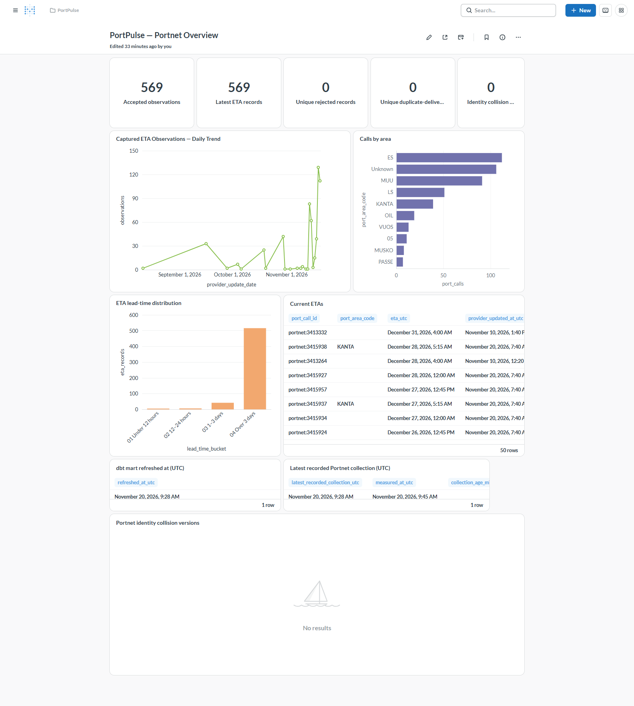
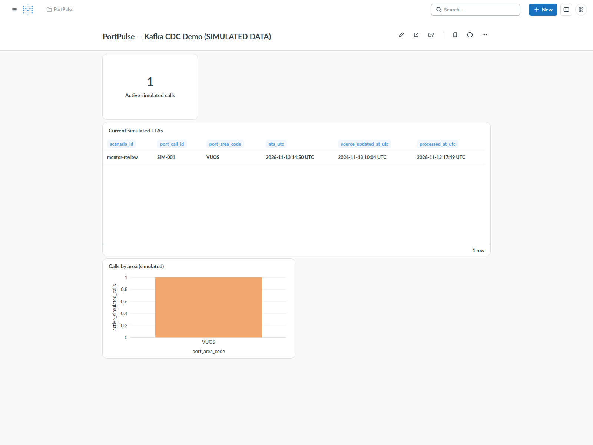
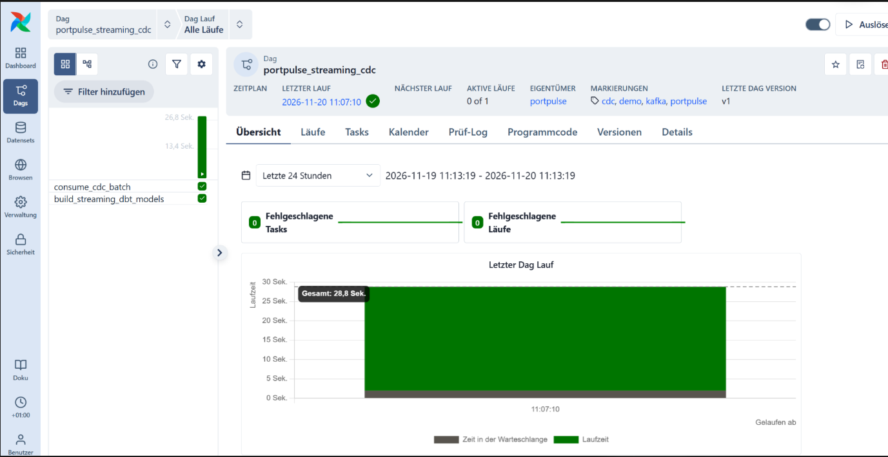

# PortPulse

PortPulse is a local data engineering demo for Finnish port-call ETAs. It collects live Portnet data, generates a deterministic synthetic dataset, stores both in PostgreSQL, builds dbt analytics, and displays results in Metabase. Kafka CDC is an optional, separate simulation.

## Install and run

Use Git, Docker Engine or Docker Desktop with Linux containers, Docker Compose v2, and a Bash-compatible terminal. On Windows, use WSL 2 with Docker Desktop integration. The project has no documented minimum CPU or memory requirement; Docker needs enough resources to build and run Airflow, PostgreSQL, Metabase, Kafka, and Kafka Connect together. Network access is needed to download images and reach Digitraffic for live data.

Check that Git and Docker work:

```sh
git --version
docker --version
docker compose version
docker info
```

Choose either mirrored repository. The personal repository is private and requires authorized GitHub access. The DCI mirror may also require repository access.

```sh
git clone https://github.com/aminnkhann/portpulse.git portpulse
cd portpulse
```

Or clone the DCI mirror:

```sh
git clone https://github.com/dci-fbw-dataeng-python-25-a/amin-final-project.git amin-final-project
cd amin-final-project
```

Run the remaining commands from the cloned project directory. Compose binds services to localhost. Default host ports are Airflow `8080`, Metabase `3000`, PostgreSQL `5432`, and Kafka Connect `8083`; Kafka is available only inside the Compose network. To override local credentials, copy `.env.example` to `.env` and edit its values before startup. Otherwise, the demo defaults work.

Validate the Compose file and build the services:

```sh
docker compose config -q
docker compose up --build -d
```

Wait for initialization and inspect services, including one-shot jobs:

```sh
docker compose ps -a
```

`db`, `metabase`, `kafka`, and `kafka-connect` should become healthy; `airflow` should be running. `bi-setup`, `cdc-topic-setup`, `cdc-setup`, and `kafka-volume-init` should exit successfully.

Open [Airflow](http://localhost:8080) and sign in with `admin` / `admin` unless you changed the Airflow credentials in `.env`. Trigger the manual `portpulse_full_pipeline` DAG. A successful run has all four tasks in **Success**:

- `fetch_real_portnet`
- `generate_synthetic_eta`
- `ingest_synthetic_eta`
- `build_analytics`

The default Portnet window covers the DAG run's UTC date and the six preceding days. The synthetic branch creates 1,000 fictional calls with seed 42. dbt runs after both ingestion branches finish.

## Expected results

The screenshots below show a verified Windows Docker run from 20 November 2026. They are examples of completed runs, not promises that live Portnet data will stay the same.

### Airflow full pipeline


All four task instances succeeded. In this run, `fetch_real_portnet` succeeded on its second attempt after the datetime fix. The displayed 5 minute 24 second duration includes its retry wait, so it is not a processing-speed benchmark.

### Metabase dashboards

Open [Metabase](http://localhost:3000). The local default login is `admin@example.test` / `portpulse-local-demo-2026`, unless you changed the Metabase credentials in `.env`.

**PortPulse — Portnet Overview** shows captured real API observations. This snapshot had 569 accepted observations and 569 latest ETA records, with zero unique rejected records, duplicate-delivery issues, and identity collisions. These live counts vary by API response and may be zero; an [earlier empty capture](docs/images/portnet_overview.png) is also a valid result. Collection time and dbt refresh time are distinct.



**PortPulse — Synthetic ETA Analytics (SIMULATED DATA)** uses the isolated seed-42 dataset. Its expected results are:

| Result | Count |
|---|---:|
| Fictional calls and latest ETAs | 1,000 |
| Accepted ETA observations | 3,496 |
| ETA revisions after each call's first observation | 2,496 |
| Rejected events | 90 |
| Duplicate-delivery issues | 142 |
| Identity collisions | 0 |


**PortPulse — Kafka CDC Demo (SIMULATED DATA)** shows only fictional PostgreSQL changes. This example capture has one active simulated call, `SIM-001`, at ETA `2026-11-13 14:50 UTC`.



Synthetic ETA revisions describe changes to estimates; they are not actual arrival delays or measured prediction accuracy. The complete Windows run and query results are in [Windows Docker results](docs/windows_docker_results.md).

## Read-only PostgreSQL checks

These queries only read stored counts. Portnet counts depend on the live API; the seed-42 values are repeatable after the full DAG succeeds.

```sh
docker compose exec -T db psql -U portpulse -d portpulse -c 'SELECT count(*) AS portnet_observations FROM portnet_eta_observation;'
docker compose exec -T db psql -U portpulse -d portpulse -c 'SELECT count(*) AS synthetic_observations FROM synthetic_demo.eta_observation;'
docker compose exec -T db psql -U portpulse -d portpulse -c 'SELECT count(*) AS latest_synthetic_etas FROM analytics.mart_synthetic_eta_latest_eta;'
docker compose exec -T db psql -U portpulse -d portpulse -c 'SELECT count(*) AS latest_portnet_etas FROM analytics.mart_portnet_latest_eta;'
```

## Optional Kafka CDC demonstration

CDC is separate from `portpulse_full_pipeline`. Check that Kafka Connect and Debezium are ready before creating changes:

```sh
curl -fsS http://localhost:8083/connectors/portpulse-postgres-cdc/status
```

Use a fresh scenario ID each time:

```sh
SCENARIO_ID="demo-$(date +%s)"
docker compose exec -T airflow python scripts/simulate_port_traffic.py --scenario-id "$SCENARIO_ID" --delay-seconds 0
docker compose exec -T airflow airflow dags unpause portpulse_streaming_cdc
```

Then trigger `portpulse_streaming_cdc` in Airflow. The expected history is two creates, two updates, and one delete (`c,u,u,c,d`). The latest-state mart retains `SIM-001` at `2026-11-13 14:50:00+00` and omits deleted `SIM-002`.



See the [CDC guide](docs/streaming_cdc.md) for connector setup and exact database checks.

## Troubleshooting

| Problem | Safe check |
|---|---|
| Docker is unavailable | Run `docker info` and `docker compose version`; start Docker Engine/Desktop if the daemon is stopped. |
| A host port is occupied | Check `docker compose ps -a`; change `AIRFLOW_PORT`, `METABASE_PORT`, `POSTGRES_PORT`, or `KAFKA_CONNECT_PORT` in `.env`, then run `docker compose up -d`. |
| A service is unhealthy or a setup job failed | Run `docker compose ps -a` and `docker compose logs --tail 100 db metabase kafka kafka-connect airflow bi-setup cdc-topic-setup cdc-setup`. |
| Airflow is unavailable or a task failed | Run `docker compose logs --tail 100 airflow`, then open the failed task log in Airflow. |
| PostgreSQL or dbt cannot connect | Run `docker compose exec -T db pg_isready -U portpulse -d portpulse` and check `docker compose logs --tail 100 db airflow bi-setup`. |
| Metabase dashboards are missing | Run `docker compose logs bi-setup metabase` and confirm `bi-setup` exited successfully. |
| Digitraffic returns no eligible ETAs | This can be a valid live result. Check the `fetch_real_portnet` task log; do not expect a fixed live count. |
| Kafka Connect or CDC is not ready | Check `docker compose ps -a`, `docker compose logs --tail 100 kafka kafka-connect cdc-setup`, and `curl -fsS http://localhost:8083/connectors/portpulse-postgres-cdc/status`. |

See [Metabase dashboards](docs/metabase.md), [Database operations](docs/database.md), and the [CDC guide](docs/streaming_cdc.md) for detailed troubleshooting.

## Stop safely

Stop containers and retain their data:

```sh
docker compose stop
```

Restart later with `docker compose up -d`. `docker compose down` also retains named volumes. Do not use `docker compose down -v` unless you intend to delete local PostgreSQL and service data.

For troubleshooting and detailed database operations, see [Metabase dashboards](docs/metabase.md), [Database operations](docs/database.md), the [CDC guide](docs/streaming_cdc.md), and the [final acceptance checklist](docs/final_acceptance_checklist.md). The clean-clone acceptance status remains **NOT RUN** until someone runs it.
