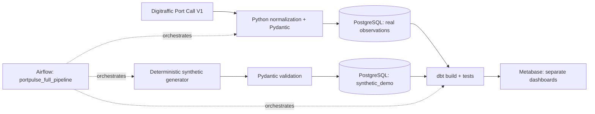

# PortPulse

**A local, end-to-end Data Engineering portfolio project for maritime estimated time of arrival (ETA) data.**

PortPulse demonstrates ingestion, schema validation, data quality, PostgreSQL persistence, Airflow orchestration, dbt transformations, Metabase dashboards, and a separate Debezium/Kafka change-data-capture (CDC) demo.

**Main user journey:** clone → `docker compose up -d --build` → trigger **one Airflow DAG** → examine **real and deterministic synthetic** analytics in Metabase. The optional CDC demo is a **separate** manual workflow.

> **Project maturity (19 November 2026):** The full Airflow pipeline, 5-event CDC demonstration, 75 dbt build/test nodes, and three Metabase dashboards have been verified in an existing local environment. The latest GitHub `main` CI passed. A completely independent clean-clone acceptance run has **not yet been recorded**, so do not call this a fully verified one-command installation or production deployment. See [engineering assessment](docs/engineering_readiness_assessment.md).

## Architecture at a glance



The **optional simulated CDC path** is separate:

```text
Simulated PostgreSQL changes → logical WAL → Debezium → Kafka
  → Airflow CDC consumer → PostgreSQL CDC history → dbt → Metabase
```

Synthetic observations and CDC events are **fictional** and never represented as real maritime observations.

## Quickstart: one Airflow trigger

### 1. Requirements

- Docker Engine with Docker Compose v2
- Git and enough local disk/memory for PostgreSQL, Airflow, Kafka, Kafka Connect, and Metabase
- Network access to fetch container images and query the Digitraffic API
- GitHub access to this repository (it is currently **private**)

Run from a **new checkout**:

```bash
git clone https://github.com/aminnkhann/portpulse.git
cd portpulse
docker compose up -d --build
docker compose ps -a
```

On a new database volume, migrations `001`–`010` run automatically. One-shot `cdc-topic-setup` and `cdc-setup` should both finish with `Exited (0)`. The `bi-setup` job builds the initial dbt marts and sets up Metabase, and should also finish successfully. Long-running services should become healthy or running. Check their logs if initialization is not yet complete:

```bash
docker compose logs --tail=50 cdc-topic-setup cdc-setup
docker compose logs --tail=50 bi-setup
docker compose logs --tail=50 airflow
```

**Local-only demo accounts:** Airflow `admin` / `admin`; Metabase `admin@example.test` / `portpulse-local-demo-2026`. Override defaults through variables documented in [.env.example](.env.example). Do not expose this installation or its example credentials to the internet.

- Airflow: http://localhost:8080
- Metabase: http://localhost:3000
- Kafka Connect status: http://localhost:8083/connectors/portpulse-postgres-cdc/status

### 2. Run the complete real + synthetic pipeline

In Airflow, trigger `portpulse_full_pipeline` **once**. It is manual-only (`schedule=None`) and initially unpaused. Equivalent CLI:

```bash
docker compose exec -T airflow airflow dags trigger portpulse_full_pipeline
```

The DAG has four tasks:

1. `fetch_real_portnet` — requests seven UTC dates from Digitraffic Port Call V1 by default, normalizes and validates eligible ETA details, and stores observations/rejections/quality issues.
2. `generate_synthetic_eta` — generates a deterministic fictional 1,000-call dataset using seed 42.
3. `ingest_synthetic_eta` — validates, quarantines, deduplicates, and stores the fictional observations separately.
4. `build_analytics` — runs the full `dbt build` after **both** input branches succeed.

The real fetch and synthetic generator can run independently; synthetic ingestion waits for generation. **If either ingestion branch fails, the final dbt task does not run**, and the DAG does not report success. Metabase is a reader of the resulting marts, not an Airflow task.

For a deliberate manual backfill and custom synthetic scenario:

```bash
docker compose exec -T airflow airflow dags trigger portpulse_full_pipeline \
  --conf '{"run_date":"2026-11-17","lookback_days":7,"port_calls":1000,"seed":42}'
```

Configuration: `run_date` is a UTC calendar date, `lookback_days` is 1–30, `port_calls` is 1–1,000, and `seed` is an integer. Replaying the same synthetic seed and call count gives the same **valid observations**; repeated loads don't add duplicate accepted rows. **Live API responses and real record counts can vary**, even for identical date filters.

### 3. Verify the data and dashboards

First confirm all four task instances are green in the Airflow UI. Then run:

```bash
docker compose exec -T db psql -U portpulse -d portpulse \
  -c "SELECT count(*) AS real_observations FROM public.portnet_eta_observation;"

docker compose exec -T db psql -U portpulse -d portpulse \
  -c "SELECT accepted_observations, rejected_events, duplicate_issues, collision_issues FROM analytics.mart_synthetic_eta_quality;"

docker compose exec -T db psql -U portpulse -d portpulse \
  -c "SELECT count(*) AS synthetic_latest_calls FROM analytics.mart_synthetic_eta_latest_eta;"
```

For the **default synthetic seed 42 and 1,000 calls on a fresh database**, expected cumulative synthetic metrics are **3,496 accepted ETA observations, 90 rejected events, 142 duplicate issues, 0 collisions, and 1,000 latest calls**. These represent ETA **updates and revisions**, *not actual arrival delays*.

For real data, there is **no fixed minimum row-count promise**. A successful API poll may have no eligible ETA details. Use the Airflow logs and ingestion counters to understand what each request returned.

Metabase creates **three distinct dashboards** under the `PortPulse` collection:

| Dashboard | Source | Interpretation |
|---|---|---|
| PortPulse — Portnet Overview | Live Digitraffic | Collected, eligible **real** ETA observations |
| PortPulse — Synthetic ETA Analytics (SIMULATED DATA) | `synthetic_demo` | Fictional ETA revisions, activity, and quality |
| PortPulse — Kafka CDC Demo (SIMULATED DATA) | `stream_demo` | Optional simulated change capture; empty until CDC is run |

For the setup details and dashboard behavior, see [Metabase documentation](docs/metabase.md).

## Optional: run the Kafka CDC demonstration

Kafka, Kafka Connect, and Debezium start with Compose. The topic is created by `cdc-topic-setup`; the connector is registered by `cdc-setup`. **No manual topic creation is required on a fresh stack.** The `portpulse_streaming_cdc` DAG is manual-only and starts paused.

```bash
# Verify Debezium is running before generating the simulated changes
curl -fsS http://localhost:8083/connectors/portpulse-postgres-cdc/status

# Use a new scenario name to avoid primary-key collisions
docker compose exec -T airflow python scripts/simulate_port_traffic.py \
  --scenario-id "demo-$(date +%s)" --delay-seconds 1

docker compose exec -T airflow airflow dags unpause portpulse_streaming_cdc
docker compose exec -T airflow airflow dags trigger portpulse_streaming_cdc
```

Check that both CDC DAG tasks succeed, then inspect the stored history and latest-state mart:

```bash
docker compose exec -T db psql -U portpulse -d portpulse \
  -c "SELECT scenario_id, operation, count(*) FROM stream_demo.port_eta_cdc_event GROUP BY scenario_id, operation ORDER BY scenario_id, operation;"

docker compose exec -T db psql -U portpulse -d portpulse \
  -c "SELECT scenario_id, port_call_id, eta_utc, cdc_operation FROM analytics.mart_stream_latest_eta ORDER BY scenario_id, port_call_id;"
```

A fresh five-change scenario yields 2 creates, 2 updates, 1 delete, and one surviving `SIM-001` ETA of `2026-11-13 14:50:00+00`; a Kafka deletion tombstone is expected. The CDC consumer is bounded to 100 Kafka messages **per trigger**, so accumulated topic history may take more than one manual run to process. See [CDC guide](docs/streaming_cdc.md).

## Validation, testing, and CI

- **Real Portnet input:** provider-specific structural checks, then Pydantic `MarineEtaEvent` and `PortnetEtaPayload` for normalized ETA details; invalid or ambiguous details are quarantined.
- **Synthetic input:** Pydantic `PortCallEvent` and generated JSON Schema in `contracts/`; invalid events are quarantined in `synthetic_demo`.
- **CDC input:** explicit JSON/envelope, identity, operation, and timestamp checks in Python; **it does not currently use a Pydantic model**.
- **Persistence:** PostgreSQL unique constraints and canonical payload hashes support repeat-safe accepted observations; repeated real API polls can still add duplicate **quality-issue rows**.
- **Analytics:** dbt staging/marts and tests; source freshness monitoring is **not implemented**.

Run the existing test suite in the application container:

```bash
docker compose exec -T airflow python -m unittest discover -s tests -v
docker compose exec -T airflow dbt build --project-dir /opt/portpulse/dbt
```

The default GitHub Actions CI runs lint/format checks, Airflow DAG imports, Python tests, PostgreSQL integration tests, and dbt build/tests. Separate BI and CDC integration smoke workflows exist as **manual `workflow_dispatch` jobs**; passing default CI alone does not prove a fresh Docker deployment. Read the [acceptance checklist and assessment](docs/engineering_readiness_assessment.md).

## Scope and current limitations

- **API interchangeability is not implemented.** Port Call V1 URL, request parameters, payload fields, and `source_id="portnet"` are coupled to the current source. Simply changing the URL to another ETA provider or Port Call V2 will not work without an adapter. Building a well-tested source adapter is the next development priority.
- **Provider lifecycle:** Digitraffic [announced](https://www.digitraffic.fi/en/news/2026/11/13/port-call-v1-en.html) that Port Call V1 stops receiving new data on **1 January 2027** and is removed on **1 July 2027**. Port Call V2 differs in content.
- **Reproducibility:** the same fixed synthetic inputs produce the same accepted synthetic dataset. Live API data are dynamic and cannot be promised to produce the same counts on a different day or new machine.
- **Operations:** local learning/demo platform, single Kafka broker, Airflow metadata in SQLite, basic task logs, and demo credentials. It is **not** a hardened production service.
- **Fresh-clone acceptance:** not yet independently verified; do not describe the project as deployment-certified.

## Documentation

- [Professional engineering assessment and prioritized roadmap](docs/engineering_readiness_assessment.md)
- [Architecture](ARCHITECTURE.md)
- [Database operations and migrations](docs/database.md)
- [Data dictionary and event semantics](docs/data_dictionary.md)
- [Synthetic ETA demonstration](docs/synthetic_eta.md)
- [Kafka CDC demonstration](docs/streaming_cdc.md)
- [Metabase dashboards](docs/metabase.md)

**Stop without deleting data:**

```bash
docker compose down
```

Do **not** use `docker compose down -v` or prune volumes on a dataset you want to keep. Compose named volumes are tied to a project name: use the same working directory/Compose project identity to reconnect to the same stored data.
