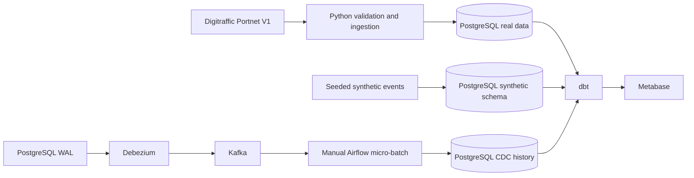

# PortPulse

PortPulse is an educational data engineering project that captures Finnish port-call ETAs, stores provider observations, and builds queryable analytics. It also demonstrates deterministic synthetic ETA analysis and a separate PostgreSQL CDC path.

## Architecture



Synthetic analytics and CDC demonstrations are fictional and remain separate from live Portnet records. The CDC consumer runs only when its Airflow DAG is triggered; it is not a continuously running end-to-end stream.

## Run locally

Prerequisites: Docker Engine, Docker Compose v2, and a network connection for Digitraffic Portnet V1.

```sh
git clone https://github.com/aminnkhann/portpulse.git
cd portpulse
docker compose up --build -d
```

Open [Airflow](http://localhost:8080), trigger the unpaused `portpulse_full_pipeline` DAG, then open [Metabase](http://localhost:3000). The pipeline collects seven UTC dates of real Portnet data, generates 1,000 fictional calls with seed 42, and builds dbt models. The API response and observation counts depend on the live source.

Metabase includes three separate dashboards: **Portnet Overview** (real source observations), **Synthetic ETA Analytics** (fictional generated events), and **Kafka CDC Demo** (fictional PostgreSQL changes).

The local-only demo logins are `admin` / `admin` for Airflow and `admin@example.test` / `portpulse-local-demo-2026` for Metabase. Set local overrides in `.env`; never expose these defaults to a public deployment. Do not run `docker compose down -v`: it deletes persistent volumes. See [database operations](docs/database.md) before applying migrations to an existing database.

## Tests

Run Python tests in the application container and lint/format checks on a host with the development requirements installed:

```sh
docker compose exec airflow python -m unittest discover -s tests -v
python -m pip install -r requirements-dev.txt
ruff check .
ruff format --check .
```

## Known limitations

- This is a local educational project, not a production service. Large-scale performance has not been demonstrated; ingestion writes rows individually and dbt rebuilds full tables.
- The adapter uses Digitraffic Port Call V1. V1 will eventually stop providing new data; a V2 adapter is future work.
- Pydantic validates normalized event models. It does not validate every raw API message.
- Actual vessel arrival timestamps are not persisted for comparing estimates with outcomes, so the project does not establish ETA prediction accuracy.
- ETA lead time and changes to a fictional or live ETA are not actual vessel delay.
- Portnet source update, collection, database ingestion, and dbt refresh times have different meanings. A successful dbt run does not establish that the source is fresh.

## Documentation

- [Architecture](ARCHITECTURE.md)
- [Database operations and migration notes](docs/database.md)
- [Data dictionary](docs/data_dictionary.md)
- [Metabase dashboards](docs/metabase.md)
- [Synthetic ETA demo](docs/synthetic_eta.md)
- [CDC guide and catch-up procedure](docs/streaming_cdc.md)
- [Engineering baseline assessment](docs/engineering_readiness_assessment.md)
- [Final clean-clone acceptance checklist](docs/final_acceptance_checklist.md)
- [Presentation query (result awaiting verification)](docs/presentation_finding.md)
