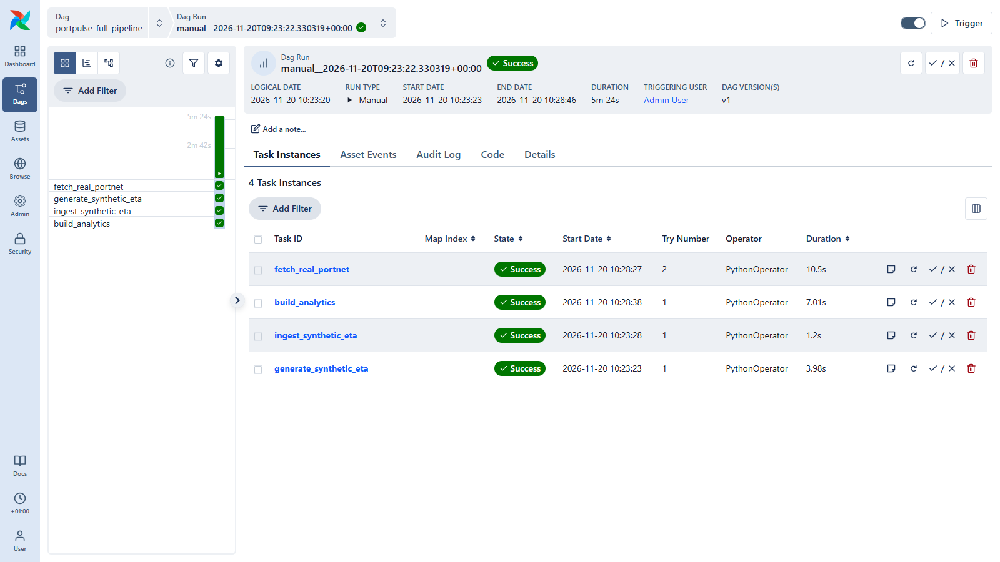

# Windows Docker results — 20 November 2026

These results were captured from the Windows Docker installation used in this session. Airflow and Metabase were running locally at `localhost:8080` and `localhost:3000`. This records the observed results on that host after resolving the startup script's Windows line endings and the Portnet task's datetime conversion error.

The three main-run PNGs are unaltered browser screenshots of Airflow and Metabase, rendered with the installed Chrome browser in headless mode on 20 November 2026. Dashboard values were checked against read-only PostgreSQL queries. Separate CDC Airflow and earlier CDC dashboard screenshots are also linked below. These captures document this Windows installation.

## Environment and run

| Item | Observed value |
|---|---|
| Host | Windows, Docker with Linux containers |
| Docker client / engine | 29.9.3 / 29.9.3 |
| Docker Compose | 5.7.0 |
| Airflow | 3.4.0, Python 3.12 image |
| Metabase | `metabase/metabase:v0.65.4.x` |
| PostgreSQL | `postgres:16-alpine` |
| DAG | `portpulse_full_pipeline` |
| Run ID | `manual__2026-11-20T09:23:22.330319+00:00` |
| Run started / finished | 09:23:23 / 09:28:46 UTC, 20 November 2026 |

The running application includes the Portnet datetime fix ([personal PR #39](https://github.com/aminnkhann/portpulse/pull/39), [DCI PR #42](https://github.com/dci-fbw-dataeng-python-25-a/amin-final-project/pull/42)), using personal-repository commit `d2cb483`. The startup script was normalized to LF before rebuilding Airflow; [personal PR #38](https://github.com/aminnkhann/portpulse/pull/38) and [DCI PR #41](https://github.com/dci-fbw-dataeng-python-25-a/amin-final-project/pull/41) add the Git rule that preserves those line endings in future checkouts. These implementation changes are separate from this documentation.

## Airflow: complete pipeline succeeded



The run and all four task instances show **Success**:

| Task | What its success means |
|---|---|
| `generate_synthetic_eta` | Generated the default fictional dataset: 1,000 port calls, seed 42. |
| `ingest_synthetic_eta` | Validated and ingested the generated events, with rejected and duplicate events handled separately. |
| `fetch_real_portnet` | Completed the real Portnet ingestion requests for the default seven-date window. |
| `build_analytics` | Ran `dbt build` after both ingestion branches completed, building models and running their data tests. |

The fetch succeeded on **attempt 2** after the datetime conversion fix. The other tasks succeeded on their first attempt. The displayed duration of about five minutes includes the retry wait and is not a processing-speed benchmark. Airflow displays times in **UTC+01:00** in this screenshot; the run ID and times in the environment table use UTC.

## Metabase: Portnet Overview — real API data


At capture time, the real-data dashboard showed **569 accepted observations** and **569 latest ETA records**. Unique rejected records, duplicate-delivery problems, and identity collision groups were all **0**. The empty identity-collision table is consistent with that zero count.

The trend groups captured observations by **provider update date**. Older update dates can therefore appear even though the ingestion requests ran today. This chart describes the captured records, rather than a complete history of Finnish port traffic. Calls by area and ETA lead-time buckets summarize the latest recorded ETAs; `Unknown` indicates a missing port-area value.

The bottom cards distinguish the dbt refresh time from the latest recorded payload collection time. Both show approximately **09:28 UTC** for this run. Collection age increases as time passes and does not prove the provider is currently reachable. Live-data counts can differ on a later run.

## Metabase: Synthetic ETA Analytics — simulated data


The default seed-42 dataset produced these verified results:

| Metric | Count |
|---|---:|
| Fictional port calls / latest ETAs | 1,000 |
| Accepted ETA observations / updates | 3,496 |
| ETA revisions after a call's first observation | 2,496 |
| Rejected events | 90 |
| Duplicate-delivery issues | 142 |
| Identity collision issues | 0 |

The charts show daily synthetic activity, contributions from the three simulated sources, revision direction, and ingestion-quality results. The rejected and duplicate events are intentional test inputs. They exercise validation and duplicate handling while the accepted events populate analytics.

An ETA moving later means the estimated time changed; an ETA moving earlier means the estimate was brought forward. Neither measures actual arrival delay or prediction accuracy. January dates belong to the fixed fictional dataset, even though the pipeline ran in November. This dashboard remains separate from real Portnet observations.

## Kafka CDC — additional Windows verification

The owner reports a separate Windows CDC run with the following results. The existing [CDC Airflow screenshot](images/portpulse-streaming-cdc-airflow-success.png) shows a successful portpulse_streaming_cdc run with both task rows green. The accompanying owner verification reports that the Debezium connector and its task were RUNNING before simulation; a fresh scenario produced two creates, two updates, and one delete; both consume_cdc_batch and build_streaming_dbt_models succeeded; and Kafka consumer lag was zero on all three topic partitions.

The reported latest-state result for that scenario contained only SIM-001 at 2026-11-13 14:50:00+00. SIM-002 had been deleted. A later Metabase dashboard view reportedly showed ten cumulative CDC events and two active simulated calls from two completed scenarios. These cumulative values are expected when exactly two such scenarios are stored and no other scenarios exist; they are not guaranteed for an existing database.

The repository does not contain the later CDC Metabase screenshot. The older [CDC dashboard image](images/cdc_demo.png) shows one active call in the mentor-review scenario; it does not evidence the later ten-event/two-call view. The selected scenario ID, the CDC Airflow run ID, the exact capture time for the later dashboard, and a screenshot or saved command output for connector status and per-partition lag were not supplied. The reported values are therefore distinguished here from the directly reviewable screenshot evidence.

The README's [CDC reproduction steps](../README.md#optional-kafka-cdc-demonstration) provide the copy-pasteable Windows PowerShell and Bash commands. These read-only queries check cumulative dashboard values:

```sql
SELECT count(*) AS cdc_events FROM analytics.stg_stream_eta_changes;
SELECT count(*) AS active_simulated_calls FROM analytics.mart_stream_latest_eta;
SELECT scenario_id, port_call_id, port_area_code, eta_utc
FROM analytics.mart_stream_latest_eta
ORDER BY scenario_id, port_call_id;
```

For one selected scenario, query stream_demo.port_eta_cdc_event by scenario_id and group by operation; the expected result is c = 2, u = 2, d = 1. Query analytics.mart_stream_latest_eta for that same scenario to confirm only SIM-001 remains at the expected ETA. The run-specific query is in the README because the scenario ID must be generated anew for each execution.

Each completed scenario contributes five stored Debezium operation rows and one active simulated call. Therefore two scenarios produce ten cumulative operation rows and two active calls only when the database contains those two scenarios alone. Existing data can raise either dashboard total.

## Verification

All six screenshots currently stored under docs/images were visually inspected. The Airflow CLI confirmed the main run and all four tasks were successful. Read-only SQL checks confirmed the observation, latest-ETA, revision, and synthetic quality totals above. The two main-run Metabase dashboards rendered their charts and tables without a browser page error during capture. The owner reports the CDC results summarized above; the later CDC Metabase screenshot and CDC run metadata are missing from this repository.

This report documents prior runs; this documentation update does not rerun ingestion or change application behavior. To reproduce the main workflow, follow [Reproduce and Verify the Results](../README.md#reproduce-and-verify-the-results); follow the [CDC guide](streaming_cdc.md) for connector and micro-batch details. The full [final acceptance checklist](final_acceptance_checklist.md) remains NOT RUN because its complete set of repeat-run and acceptance-record checks has not been reported as completed.
