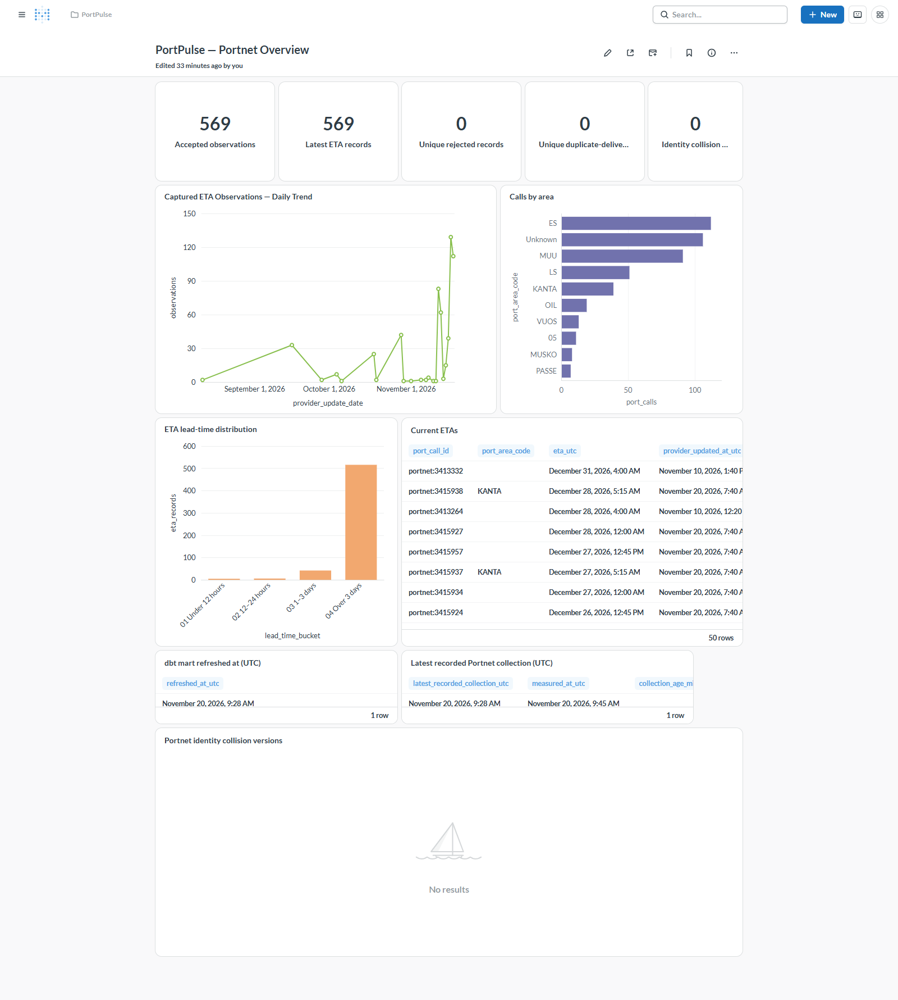
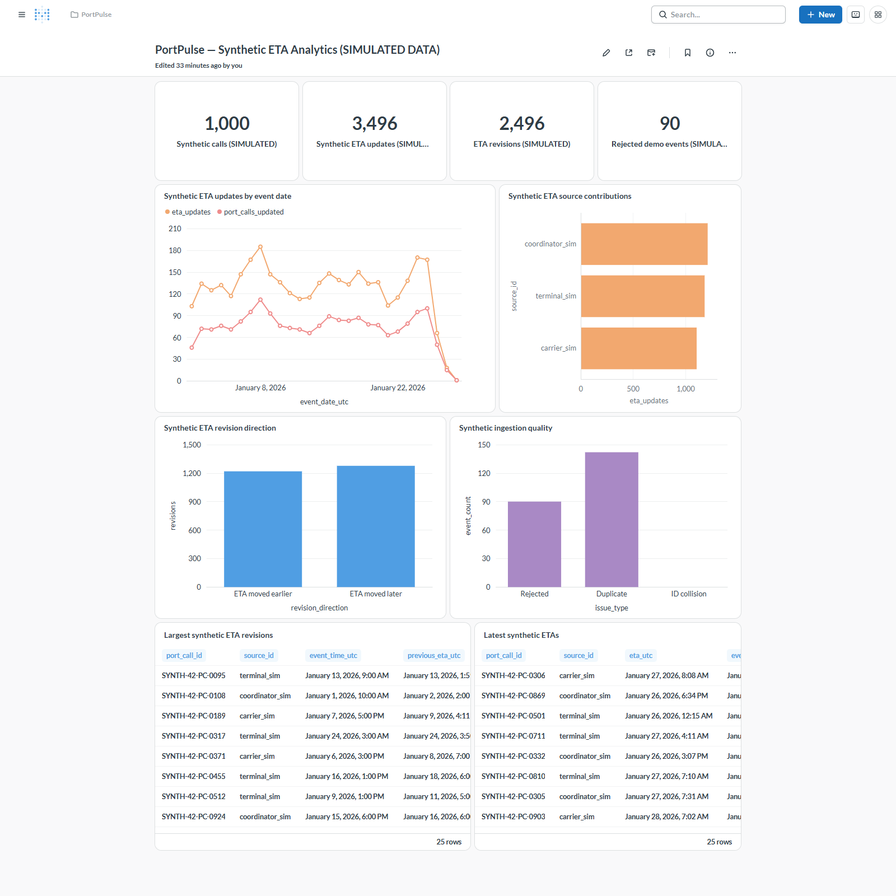
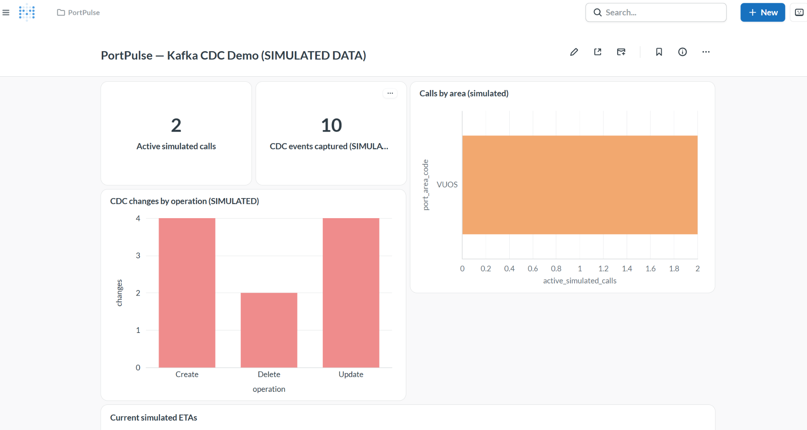

# Windows Docker results — 20 November 2026

These results were captured from the Windows Docker installation used in this session. Airflow and Metabase were running locally at `localhost:8080` and `localhost:3000`. This records the observed results on that host after resolving the startup script's Windows line endings and the Portnet task's datetime conversion error.

The three main-run PNGs are unaltered browser screenshots of Airflow and Metabase, rendered with the installed Chrome browser in headless mode on 20 November 2026. Dashboard values were checked against read-only PostgreSQL queries. Separate CDC Airflow and earlier CDC dashboard screenshots are also linked below. These captures document this Windows installation.

## Environment and run

| Item | Observed value |
|---|---|
| Host | Windows, Docker with Linux containers |
| Docker client / engine | 29.9.3 / 29.9.3 |
| Docker Compose | 5.7.0 |
| Airflow | 3.4.0, Python 3.12 image |
| Metabase | `metabase/metabase:v0.65.4.x` |
| PostgreSQL | `postgres:16-alpine` |
| DAG | `portpulse_full_pipeline` |
| Run ID | `manual__2026-11-20T09:23:22.330319+00:00` |
| Run started / finished | 09:23:23 / 09:28:46 UTC, 20 November 2026 |

The running application includes the Portnet datetime fix ([personal PR #39](https://github.com/aminnkhann/portpulse/pull/39), [DCI PR #42](https://github.com/dci-fbw-dataeng-python-25-a/amin-final-project/pull/42)), using personal-repository commit `d2cb483`. The startup script was normalized to LF before rebuilding Airflow; [personal PR #38](https://github.com/aminnkhann/portpulse/pull/38) and [DCI PR #41](https://github.com/dci-fbw-dataeng-python-25-a/amin-final-project/pull/41) add the Git rule that preserves those line endings in future checkouts. These implementation changes are separate from this documentation.

## Airflow: complete pipeline succeeded


The run and all four task instances show **Success**:

| Task | What its success means |
|---|---|
| `generate_synthetic_eta` | Generated the default fictional dataset: 1,000 port calls, seed 42. |
| `ingest_synthetic_eta` | Validated and ingested the generated events, with rejected and duplicate events handled separately. |
| `fetch_real_portnet` | Completed the real Portnet ingestion requests for the default seven-date window. |
| `build_analytics` | Ran `dbt build` after both ingestion branches completed, building models and running their data tests. |

The fetch succeeded on **attempt 2** after the datetime conversion fix. The other tasks succeeded on their first attempt. The displayed duration of about five minutes includes the retry wait and is not a processing-speed benchmark. Airflow displays times in **UTC+01:00** in this screenshot; the run ID and times in the environment table use UTC.

## Metabase: Portnet Overview — real API data



At capture time, the real-data dashboard showed **569 accepted observations** and **569 latest ETA records**. Unique rejected records, duplicate-delivery problems, and identity collision groups were all **0**. The empty identity-collision table is consistent with that zero count.

The trend groups captured observations by **provider update date**. Older update dates can therefore appear even though the ingestion requests ran today. This chart describes the captured records, rather than a complete history of Finnish port traffic. Calls by area and ETA lead-time buckets summarize the latest recorded ETAs; `Unknown` indicates a missing port-area value.

The bottom cards distinguish the dbt refresh time from the latest recorded payload collection time. Both show approximately **09:28 UTC** for this run. Collection age increases as time passes and does not prove the provider is currently reachable. Live-data counts can differ on a later run.

## Metabase: Synthetic ETA Analytics — simulated data



The default seed-42 dataset produced these verified results:

| Metric | Count |
|---|---:|
| Fictional port calls / latest ETAs | 1,000 |
| Accepted ETA observations / updates | 3,496 |
| ETA revisions after a call's first observation | 2,496 |
| Rejected events | 90 |
| Duplicate-delivery issues | 142 |
| Identity collision issues | 0 |

The charts show daily synthetic activity, contributions from the three simulated sources, revision direction, and ingestion-quality results. The rejected and duplicate events are intentional test inputs. They exercise validation and duplicate handling while the accepted events populate analytics.

An ETA moving later means the estimated time changed; an ETA moving earlier means the estimate was brought forward. Neither measures actual arrival delay or prediction accuracy. January dates belong to the fixed fictional dataset, even though the pipeline ran in November. This dashboard remains separate from real Portnet observations.

## Kafka CDC — additional Windows verification

### Owner-supplied Windows run evidence (20 November 2026)

The project owner supplied a Windows PowerShell transcript, a newer Metabase CDC dashboard screenshot, and an Airflow CDC screenshot in the project conversation. The [CDC Airflow success screenshot](images/portpulse-streaming-cdc-airflow-success.png) is already committed to this repository. These observations document the successful **manual CDC micro-batch demonstration on that Windows host**; they are not a fresh execution by this documentation change.

| Check | Observed result |
|---|---|
| Docker services | PostgreSQL, Kafka, Kafka Connect, and Metabase healthy; Airflow running; `bi-setup`, `cdc-setup`, `cdc-topic-setup`, and `kafka-volume-init` exited successfully |
| Debezium connector | `portpulse-postgres-cdc` RUNNING (version `3.7.1.Final`) |
| Debezium task | Task 0 RUNNING |
| Fresh scenario ID | `acceptance-c319afe50133` |
| Source changes | INSERT `SIM-001`, UPDATE `SIM-001` twice, INSERT `SIM-002`, DELETE `SIM-002` |
| Airflow CDC run ID | `manual__2026-11-20T10:07:10.039623+00:00` |
| Airflow tasks | `consume_cdc_batch` and `build_streaming_dbt_models`: Success; screenshot shows zero failed tasks and a run lasting approximately 28.8 seconds |
| Selected-scenario CDC history | `c = 2`, `u = 2`, `d = 1` (five stored change-operation rows) |
| Selected-scenario latest state | Only `SIM-001`, `eta_utc = 2026-11-13 14:50:00+00`; deleted `SIM-002` absent |
| Kafka consumer lag | 0 for all three partitions: partition 0 at 3/3, partition 1 at 3/3, partition 2 at 6/6 (consumer offset/log end) |

The CLI reported that consumer group `portpulse-streaming-cdc` had no **active** members at the time of inspection. This is expected for a manually triggered micro-batch consumer after its work finishes; the recorded consumer offsets and zero lag are the relevant catch-up evidence.

The later **owner-provided Metabase CDC screenshot**, now committed below, visibly shows 10 cumulative CDC events (Create 4, Update 4, Delete 2), two active simulated calls, and two active calls in area `VUOS`. Those dashboard totals are consistent with two completed five-operation scenarios and one surviving call per scenario. They are **cumulative across scenarios**, not the result of the single `acceptance-c319afe50133` run alone and not fixed expectations for another database.



### Reproduction and evidence limits

The README's [CDC reproduction steps](../README.md#optional-kafka-cdc-demonstration) create a **new** scenario ID and provide PowerShell/Bash commands for connector checks, simulator changes, Airflow runs, per-scenario SQL assertions, and Kafka consumer lag. For the owner's reported scenario, the read-only SQL shape is:

```sql
SELECT operation, count(*)
FROM stream_demo.port_eta_cdc_event
WHERE scenario_id = 'acceptance-c319afe50133'
GROUP BY operation ORDER BY operation;

SELECT port_call_id, eta_utc
FROM analytics.mart_stream_latest_eta
WHERE scenario_id = 'acceptance-c319afe50133'
ORDER BY port_call_id;
```

These two queries describe how to **recheck the existing owner's run**. A fresh run must use its new scenario ID. To compare cumulative dashboard cards against the current database, query:

```sql
SELECT count(*) AS cdc_events FROM analytics.stg_stream_eta_changes;
SELECT count(*) AS active_simulated_calls FROM analytics.mart_stream_latest_eta;
SELECT scenario_id, port_call_id, port_area_code, eta_utc
FROM analytics.mart_stream_latest_eta
ORDER BY scenario_id, port_call_id;
```

**Evidence boundary:** the newer [ten-event/two-call CDC Metabase screenshot](images/windows-docker-2026-11-20/windows-cdc-metabase-2026-11-20.png) is now committed to this repository, and its Git blob matches the owner's original uploaded PNG. [`cdc_demo.png`](images/cdc_demo.png) remains a different, older scenario capture. The original terminal transcript and connector/lag output remain in the conversation rather than versioned log files. The existing CDC Airflow screenshot is also versioned and directly reviewable. Exact commands, outputs, and run IDs above were transcribed from owner-supplied evidence; this documentation update did not independently rerun the Windows stack or verify a post-merge clean clone of the latest `main`.


## Verification

The previously committed screenshots were visually inspected during the original review, and the newly committed CDC Metabase screenshot matches the owner's uploaded PNG exactly. The main Airflow run and the original two Metabase dashboards, along with their PostgreSQL totals, were checked as described above. For CDC, the owner supplied the scenario ID, exact Airflow run ID, operation counts, current-state result, connector status, zero-lag partition results, and screenshots during this conversation. The newer CDC Metabase image is now versioned in this repository; the terminal transcript remains owner-supplied conversation evidence, not a committed log file.

This report documents prior runs; this documentation update does not rerun ingestion or change application behavior. To reproduce the main workflow, follow [Reproduce and Verify the Results](../README.md#reproduce-and-verify-the-results); follow the [CDC guide](streaming_cdc.md) for connector and micro-batch details. The full [final acceptance checklist](final_acceptance_checklist.md) remains NOT RUN because its complete set of repeat-run and acceptance-record checks has not been reported as completed.
